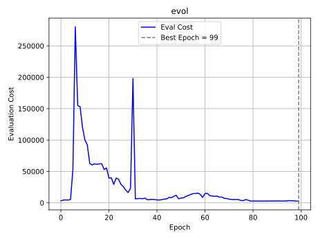
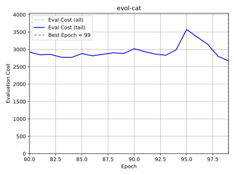
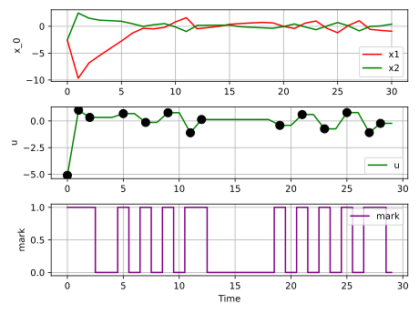

# Neural Network-Based Event-Triggered Control

## About me

山崎大翔 / 立命館大学大学院 理工学研究科 電気システム専攻（修士1年）

学部では電気電子工学を学び、現在は制御工学と機械学習を組み合わせた研究に取り組んでいます。Python、C、C++、C#、MATLABなどのプログラミング経験があり、研究では制御システムのシミュレーション、機械学習モデルの構築・評価、数式を用いた解析に取り組んでいます。

## Research background

**機械学習が下した判断を数式で再現し、その仕組みや制御への影響を理論的に解析すること**を目指しています。

研究対象は、必要なときだけ情報を送る「イベントトリガ制御」です。例えば、機械の状態が大きく変化したときにだけ情報を送れば、通信回数を抑えながら制御することができます。

私は、この「いつ情報を送るか」という判断をニューラルネットワーク（NN）に学習させています。ただし、NNはなぜその判断をしたのかが分かりにくいという課題があります。

そこで、**NNの判断をシンボリック回帰によって数式で近似・再現し、人が理解できる形にする**研究を進めています。得られた数式を使って、通信の判断条件や制御系の安定性を理論的に検討しています。

## About this repository

本リポジトリには、研究全体のうち、**NNに通信のタイミングを学習させる部分**を掲載しています。

2次元の制御システムを対象に、NNの学習、学習後の性能評価、状態の変化や通信タイミングのグラフ化までを実装しています。

※ 数式による判断の再現・解析は研究全体のテーマですが、現在掲載しているコードと実験結果は主にNNの学習・評価に関するものです。

## Control model

2次元の離散時間線形システム

$$
x_{k+1}=Ax_k+Bu_k+w_k, \qquad u_k=K\hat{x}_k
$$

を考えます。ここで、$x_k$ は制御対象の状態、$u_k$ は制御入力、$\hat{x}_k$ は最後に受信した状態、$w_k$ は外乱です。

ニューラルネットワークは現在の状態と保持状態との差分

$$
e_k=\hat{x}_{k-1}-x_k
$$

から構成した入力 $[x_k^\top,e_k^\top]^\top$ に基づいて送信を判断します。トリガ関数を $f_\theta$ とすると、評価時の送信判断は

$$
\delta_k=\begin{cases}
1 & (f_\theta(x_k,e_k)>0)\\
0 & (\text{otherwise})
\end{cases}
$$

です（初期時刻は必ず送信）。モデルには隠れ層を持つ全結合ニューラルネットワークを用いています。

学習では、状態偏差、制御入力、通信回数、および終端状態を考慮した評価関数を最小化します。

$$
J=\sum_{k=0}^{T-1}
\left(x_k^\top Qx_k+u_k^\top Ru_k+\lambda\delta_k\right)+x_T^\top Q_f x_T
$$

## Features

- PyTorchによるNNトリガとフィードバックゲイン $K$ の同時最適化
- Sigmoidによる連続緩和、およびストレートスルー推定の切替
- 学習・最良エポック選択・最終評価で独立した乱数シードを使用
- 学習履歴、評価コスト、状態軌道、通信タイミングの可視化
- 学習終了時点（Last）と選択されたモデル（Best）の比較

## Repository structure

```text
event-triggered-control/
├── 2D/                     # 二次元制御系・NN学習と評価
│   ├── README.md
│   └── DU_ETC/
│       ├── My_module/
│       │   ├── my_function_ET.py
│       │   └── plant_base.py
│       └── ETC/
│           └── Liner_system/
│               ├── plant.py
│               └── NN/
│                   ├── DETC.py
│                   ├── parameter.py
│                   ├── simulation.py
│                   ├── README.md
│                   └── Result/
├── requirements.txt
└── README.md
```

[実装と実験条件の詳細](2D/DU_ETC/ETC/Liner_system/NN/README.md) · [学習・評価コード](2D/DU_ETC/ETC/Liner_system/NN/DETC.py) · [学習モジュール](2D/DU_ETC/My_module/my_function_ET.py)

## Running the 2D project

Python、PyTorch、Matplotlib、openpyxl を利用します。以下はWindows環境での実行例です。

```powershell
python -m pip install -r requirements.txt
cd 2D\DU_ETC\ETC\Liner_system\NN
python DETC.py
```

学習後のモデルを再評価する場合は、同じディレクトリで `python simulation.py` を実行します。引数に実験結果ディレクトリを与えることもできます。初期条件や学習率、ネットワーク構造などは `parameter.py` で設定します。

## 2D experiment results

下図は2026年10月27日の実験例です。

| Parameter | Value |
|---|---|
| System | 2 states, 1 control input |
| Horizon | 30 steps |
| Epochs | 100 |
| Optimizer / Learning rate | AdamW / 0.003 |
| Network | 5 hidden layers × 8 units |
| Initial state | $x_0 \sim U([-5,5]^2)$ |
| Disturbance | $w_k \sim U([-0.2,0.2]^2)$ |
| Communication penalty | $\lambda=50$ |
| Training / validation / test seeds | 1 / 1001 / 2001 |
| Best feedback gain | $K=[0.3263,\;1.6885]$ |

### Evaluation cost

エポックごとの選択用評価コスト。破線は選択されたエポック（99、0始まり）です。



### Final epochs

学習終盤の評価コストを拡大したものです。



### Example trajectory

学習終了時のモデル（Last）による状態軌道、制御入力、および通信フラグの一例です。



[この実験の全ファイル](2D/DU_ETC/ETC/Liner_system/NN/Result/e100/lam50/x0_-5_5/dist_-0.2_0.2/DataSize64_Batch8/lr0.003/layer_5node_8/AdamW/stagecost_fixed/T30_sig_multiply_s1_r1.01/20261027_193214_072517_seed1/) · [Lastの軌道図（0〜25）](2D/DU_ETC/ETC/Liner_system/NN/Result/e100/lam50/x0_-5_5/dist_-0.2_0.2/DataSize64_Batch8/lr0.003/layer_5node_8/AdamW/stagecost_fixed/T30_sig_multiply_s1_r1.01/20261027_193214_072517_seed1/Last/Fig/) · [学習済みパラメータ](2D/DU_ETC/ETC/Liner_system/NN/Result/e100/lam50/x0_-5_5/dist_-0.2_0.2/DataSize64_Batch8/lr0.003/layer_5node_8/AdamW/stagecost_fixed/T30_sig_multiply_s1_r1.01/20261027_193214_072517_seed1/result.py)

## Notes

`My_module` と `NN` は相対インポートで参照されるため、ディレクトリ構造を保って実行してください。プロットと学習済みパラメータは、設定条件と実行日時ごとに `Result/` 以下に保存されます。
